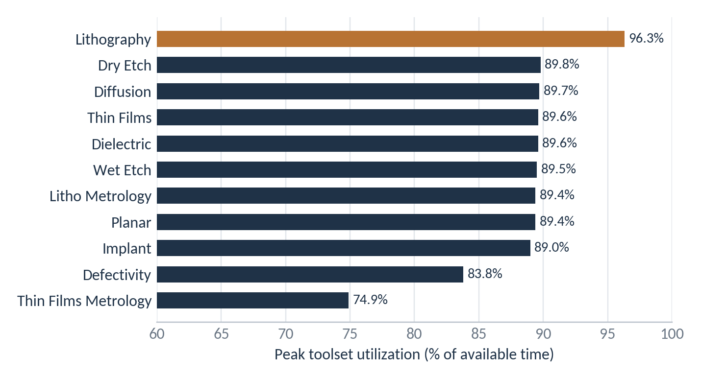
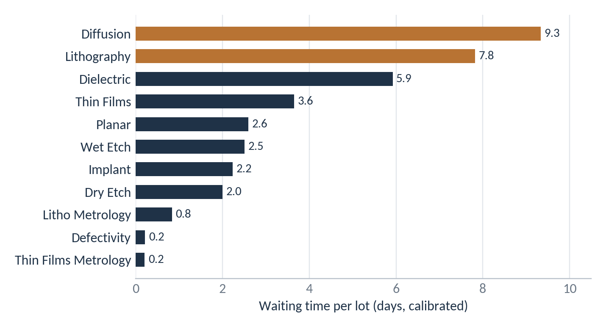
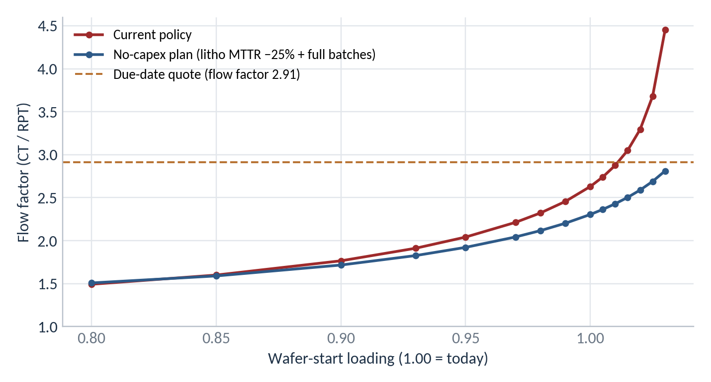
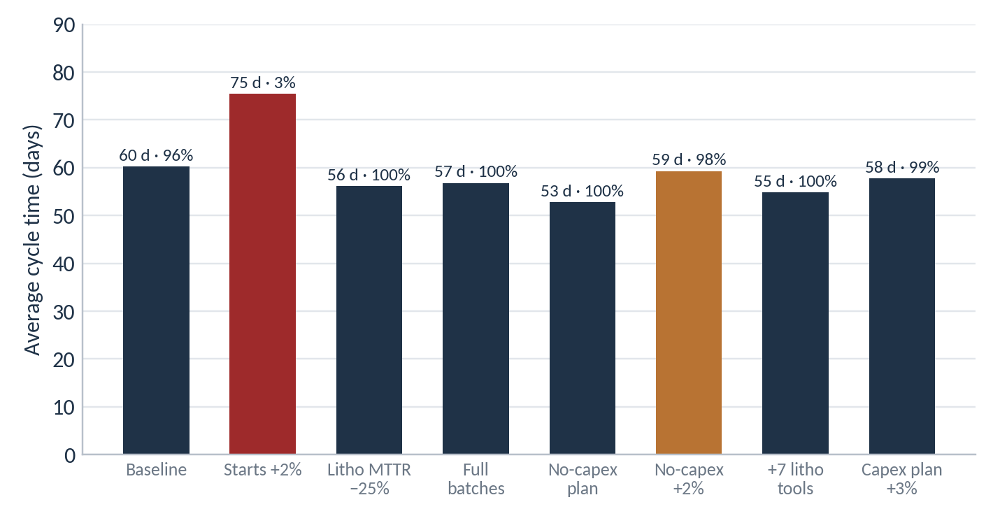
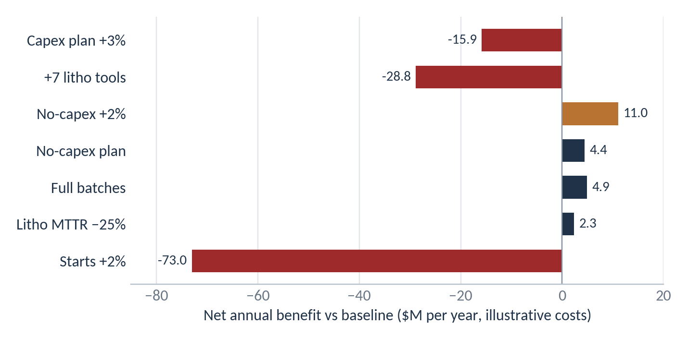

# Can the Fab Say Yes to +2%?

**Wafer-fab delivery risk and capacity decisions with a calibrated Factory Physics queueing model on the SMT2020 testbed**


An auditable Excel decision tool that tells a fab capacity planner how many more wafer starts can be committed at 95% on-time delivery, and which lever (reliability, batching or new tools) buys that headroom at the lowest annual cost. Built on public, peer-reviewed SMT2020 data (University of Hagen, Ariel University and Intel) and validated against the published simulation.

*IE6300 Manufacturing Systems Design, Northeastern University, Fall 2026.*

| 📊 [Excel model](model/smt2020_fab_delivery_risk_model.xlsx) | 📄 [Report (PDF)](report/smt2020_fab_decision_report.pdf) | 🖥️ [Presentation (PDF)](presentation/smt2020_fab_decision_presentation.pdf) |
| :---: | :---: | :---: |
| 14 sheets, 3,924 live formulas | 21 pages | 19 slides |

---

## Key results

| 60 days | 96.2% | 0% | +2% |
| :---: | :---: | :---: | :---: |
| average cycle time today | lots on time today | starts headroom at 95% service | headroom with the no-capex plan |

- **A utilization report would approve a plan that fails.** At +2% starts, peak utilization is 98.2% (below 100%, so a capacity screen calls it feasible), yet cycle time jumps from 60.2 to 75.5 days and only **2.6%** of lots ship on time.
- **Reliability beats new tools on cost.** Cutting litho repair time by 25% buys almost the same cycle time as seven new litho tools (56.2 vs 54.9 days) and breaks even at **$5.3M per year**.
- **Full five-lot diffusion batches** remove 3.4 days of cycle time; a three-lot rule would overload the furnaces.
- **Together, the two no-capex levers restore +2% headroom** at 98.0% on time, the best eligible case at +$11.0M per year (illustrative costs). Growth to +3% moves the bottleneck to dry etch, so it needs multi-area capacity.

> **Recommendation:** Do not commit +2% starts under the current policy. Launch a litho repair-time program and adopt full diffusion batches first, then release +2%. Treat growth beyond 2% as a multi-area capacity project and validate it in simulation before requesting capital.

---

## The decision question

> Given published SMT2020 Dataset 1 capacity, downtime and routing data, what is the largest wafer-start increase the fab can commit while keeping at least 95% of lots within the quoted lead time, and which combination of reliability, batching and capacity levers delivers additional headroom at the lowest annual cost?

**Intended user:** a fab capacity-planning or industrial engineer who owns the weekly wafer-start commitment and the tool-investment list, and needs a defensible answer in minutes, before commissioning a simulation study.

### Same data, opposite verdicts

| Level | Model | Sees | Misses | Verdict at +2% |
| --- | --- | --- | --- | --- |
| 1 | Capacity screen (utilization only) | Workload ÷ capacity | Variability, queues, due dates, cost | Feasible (98.2% < 100%) |
| **2** | **Calibrated queueing (this project)** | **Downtime variability, G/G/m queues, batching, service risk, cost** | **Lot-level rules, transients** | **Do not commit (2.6% on time)** |
| 3 | Discrete-event simulation (SMT2020) | Every lot, rule and event | Needs software and hours per run | Benchmark |

---

## Data

**SMT2020 Dataset 1**, a high-volume/low-mix wafer-fab testbed published in *IEEE Transactions on Semiconductor Manufacturing* (2020) and the *Winter Simulation Conference* (2019, 2020).

| Element | Value |
| --- | --- |
| Functional areas / toolsets / tools | 11 / 105 / 1,054 |
| Wafer starts | 10,200 per week (5,100 per product) |
| Product routes | 632 and 374 steps; 44 and 30 mask layers |
| Variability sources | Breakdowns, PMs, batching, setups, sampling, hot lots |
| Missing values in the tables used | 0 |

Nineteen sources were screened (IEEE TSM, WSC, testbeds reused in IJPR/EJOR, UCI, industry white papers). MIMAC (1995 technology) and UCI SECOM (no flow data, ~4.5% missing) were rejected. All links are in the workbook's **Dataset Catalogue** sheet and Appendix B of the report.

---

## Method

Every step is a visible Excel formula, computed per functional area on **Area Build** and repeated for eight scenarios on **Scenario Build**.

**1. Workload from published utilization**

$$B = \text{tools} \times A \times u \times 168, \qquad t_0 = \frac{B}{\text{lots/week} \times \text{visits/lot}}$$

**2. Downtime decomposition** (availability $A$, scheduled share $s$)

$$d_u = (1-A)(1-s), \quad d_s = (1-A)\,s, \quad m_r = \frac{168\,d_u}{A}, \quad m_p = \frac{8760\,d_s}{\text{PM events/yr}}$$

**3. Effective process variability** (Factory Physics, Ch. 8)

$$c_e^2 = c_0^2 + (1+c_r^2)\,A_u(1-A_u)\frac{m_r}{t_0} + (1+c_p^2)\,A_p(1-A_p)\frac{m_p}{t_0}$$

**4. Queue time, Kingman–Sakasegawa G/G/m**

$$CT_q = \left(\frac{c_a^2 + c_e^2}{2}\right)\left(\frac{u^{\sqrt{2(m+1)}-1}}{m(1-u)}\right) t_e, \qquad t_e = \frac{t_0}{A}$$

**5. Batching** (Factory Physics, Ch. 9): wait to form a batch of $k$ lots at arrival rate $r$ is $(k-1)/(2r)$; larger $k$ also lowers furnace utilization by $k_0/k$.

**6. Calibration**: textbook queueing under-predicts real fab waiting, so a single factor $K$ is fitted on the baseline and applied unchanged to every scenario:

$$FF = 1 + K \cdot \frac{CT_q}{RPT}, \qquad K = \frac{2.63 - 1}{FF_{\text{analytical}} - 1} = 2.22$$

**7. Service and cost**: on-time probability is the normal probability that a lot's flow factor stays below the due-date quote (published 95th percentile, 2.91); WIP follows Little's law; annual value combines margin, WIP carrying, lateness, annualized capex and program cost.

---

## Validation

| Check | Result | Status |
| --- | --- | --- |
| Toolsets and tools sum to published totals | 105 and 1,054 | ✅ Pass |
| Published regular and hot-lot interarrival times reproduced | 50.68 and 1,976.47 min | ✅ Pass |
| Model raw process time vs published | 18.2 vs 22.9 days (−20.7%) | ✅ Pass (±25%) |
| Calibrated baseline flow factor vs published median | 2.63 vs 2.63 | ✅ Pass |
| Analytical under-prediction (calibration factor K) | 2.22 | ℹ️ Reported |
| Litho maximum utilization: paper table vs text | 96.3% vs up to 98.5% | ⚠️ Open |

14 of 15 audit checks pass; the full list is on the workbook's **Audit & Checks** sheet. The uncalibrated analytical flow factor (1.73) would have understated cycle time by about 23 days.

---

## Results

### Where the time goes



Lithography is the designed constraint (seven toolsets at 96.3%), but nine of the other ten areas peak at 89–90%: a near-balanced line, the most congestion-prone configuration.



22.9 days of processing plus 37.3 days of waiting. Diffusion (9.3 days, over a third spent forming batches) and litho (7.8 days) lead; dielectric adds 5.9 days at only 89.6% utilization because 12-hour repairs interrupt half-hour jobs.

### Operating curve and headroom



Under the current policy the curve crosses the due-date quote just beyond today's loading. The no-capex plan shifts it right, supporting +2% starts (204 more wafers per week) at the same service level.

### Scenario comparison



| Scenario | Flow factor | Avg CT (days) | On time | WIP (wafers) | Bottleneck | Net vs baseline ($/yr) |
| --- | ---: | ---: | ---: | ---: | --- | ---: |
| Baseline | 2.63 | 60.2 | 96.2% | 87,759 | Litho 96.3% | $0.0M |
| Starts +2% | 3.30 | 75.5 | 2.6% | 112,149 | Litho 98.2% | −$73.0M |
| Litho MTTR −25% | 2.45 | 56.2 | 99.9% | 81,872 | Litho 94.4% | +$2.3M |
| Full diffusion batches | 2.48 | 56.8 | 99.8% | 82,787 | Litho 96.3% | +$4.9M |
| No-capex plan | 2.30 | 52.8 | 100.0% | 76,900 | Litho 94.4% | +$4.4M |
| **No-capex plan + starts +2%** | **2.59** | **59.3** | **98.0%** | **88,127** | **Litho 96.3%** | **+$11.0M** |
| +1 tool per hot litho toolset | 2.40 | 54.9 | 100.0% | 79,946 | Litho 91.4% | −$28.8M |
| Capex plan + starts +3% | 2.52 | 57.8 | 99.5% | 86,681 | Dry Etch 92.5% | −$15.9M |

### Decision economics



Cost inputs are illustrative placeholders. Two conclusions do not depend on them: the litho reliability program pays off if it costs less than $5.3M per year, and accepting +2% under the current policy loses money under any plausible lateness cost.

---

## Using the workbook

1. Download [`model/smt2020_fab_delivery_risk_model.xlsx`](model/smt2020_fab_delivery_risk_model.xlsx) and open it in Excel (GitHub cannot preview `.xlsx` files).
2. Start on **Dashboard** for KPIs, the formula-driven recommendation and charts.
3. Change only the **yellow cells** on **Assumptions**: wafer-starts multiplier, MTTR multiplier, added tools, diffusion batch threshold, due-date quote, cost inputs.
4. Trace any number back: Dashboard → Scenario Build / Area Build → Assumptions → Source sheets.

| Sheet | Purpose |
| --- | --- |
| Dashboard | KPIs, recommendation, area and scenario tables, charts |
| Assumptions | Editable levers and illustrative costs |
| Area Build | 44-column per-area calculation chain |
| Scenario Build | 8 scenarios × 11 areas; calibration factor |
| Operating Curve | Flow factor and on-time vs loading; starts headroom |
| Decision Economics | Annual cost components, ranking, break-even |
| Model Comparison | Capacity screen vs queueing model vs simulation |
| DS2 Benchmark | Hot-lot, due-date and CQT evidence from Dataset 2 |
| Source Areas / Parameters / DS2 Performance | Published tables, transcribed with page references |
| Dataset Catalogue | 19 screened sources with links |
| Audit & Checks | 15 reconciliations |
| Read Me | Lineage, color legend, modeling choices |

**Color legend:** yellow fill = editable input · blue text = typed value · green text = cross-sheet link · black text = formula.

---

## Limitations

- Aggregate, steady-state, area-level model: a commitment screen, not a lot schedule.
- Route mix by area is assumed; it affects per-visit variability, not total workload.
- A single calibration factor spreads unmodeled congestion evenly across areas.
- The source paper's table and text disagree on litho maximum utilization, so litho waiting may be understated.
- All costs are placeholders to be replaced with plant finance data.
- Ramp-up transients, engineering lots and critical-queue-time scrap are not modeled.

**Next step:** validate the recommended plan in discrete-event simulation ([PySCFabSim](https://github.com/prosysscience/PySCFabSim-release) or the full SMT2020 files) with plant cost data.

---

## Repository structure

```
smt2020-fab-delivery-risk/
├── model/
│   └── smt2020_fab_delivery_risk_model.xlsx    # decision model (14 sheets)
├── report/
│   ├── smt2020_fab_decision_report.pdf         # read in the browser
│   └── smt2020_fab_decision_report.docx        # editable source
├── presentation/
│   ├── smt2020_fab_decision_presentation.pdf   # read in the browser
│   └── smt2020_fab_decision_presentation.pptx  # editable source
├── docs/figures/                               # charts used in this README
├── LICENSE
└── README.md
```

---

## References

- Hassoun, M., Kopp, D., Mönch, L., & Kalir, A. (2019). A new high-volume/low-mix simulation testbed for semiconductor manufacturing. *Proc. Winter Simulation Conference*, 2419–2428. [PDF](http://simulation.su/uploads/files/default/2019-hassoun-kopp-monch-kalir.pdf)
- Kopp, D., Hassoun, M., Kalir, A., & Mönch, L. (2020). SMT2020: A semiconductor manufacturing testbed. *IEEE Transactions on Semiconductor Manufacturing*, 33(4), 522–531. [Dataset](https://p2schedgen.fernuni-hagen.de/index.php/downloads/simulation)
- Kopp, D., Hassoun, M., Kalir, A., & Mönch, L. (2020). Integrating critical queue time constraints into SMT2020 simulation models. *Proc. Winter Simulation Conference*, 1813–1824. [PDF](https://informs-sim.org/wsc20papers/194.pdf)
- Hopp, W. J., & Spearman, M. L. *Factory Physics* (3rd ed.). Waveland Press. Chapters 7–10.
- Chiu, W.-M. (2025). Semiconductor Back-End Assembly Scheduling Problem (SBASP) dataset. [GitHub](https://github.com/weiming0410/Semiconductor-Back-End-Assembly-Scheduling-Problem-SBASP)

---

## Author

**Sena** · MS in Industrial Engineering, Northeastern University · [LinkedIn](https://www.linkedin.com/in/your-profile)

## License

Released under the [MIT License](LICENSE). SMT2020 data belong to their original authors; see the references above.
